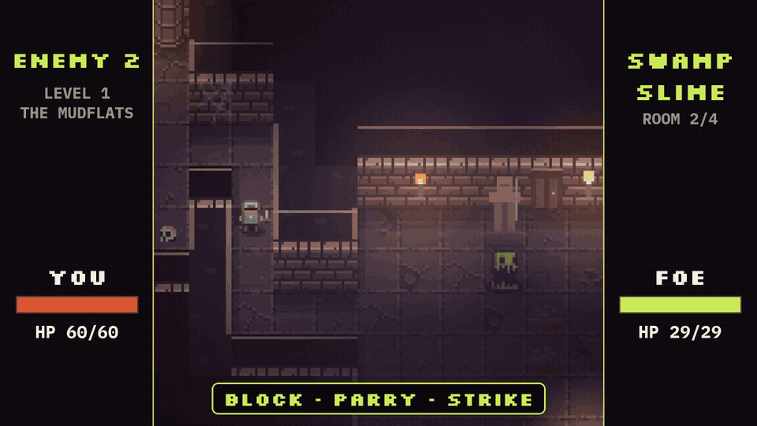
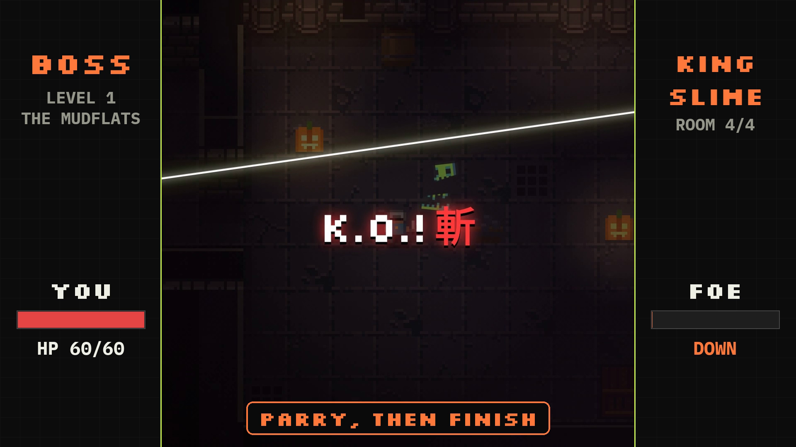

# Zeron

Zeron is a daily pixel-dungeon game on Robinhood Chain where every paid action uses the real **$WIF** token, and part of every fee is sent permanently to the dead address.

**Play now: https://zeron-game.vercel.app**

[](docs/assets/zeron-demo.mp4)

▶ [Full 43-second demo (mp4)](docs/assets/zeron-demo.mp4)

```
spend $WIF  ──►  20–50% of each fee to 0x…dEaD (gone for good) · the rest stays in the onchain prize / reward pools
pools       ──►  daily ranked top 3 paid 50/30/20 · Armory rewards capped at 65% of the last 24h inflows
players     ──►  win $WIF back and come back tomorrow for a new dungeon
```

**Live economy** (read onchain at block 110,283,289, **Nov 9, 2026 19:54 WAT**): **12.8 WIF** sent to `0x…dEaD` by Zeron · **25.7 WIF** paid out in rewards · **174.3 WIF** in the Armory reward pool · **8 WIF** in today's ranked pool. [How these were read ↓](#live-economy)

---

## What you do



Walk the town, fight real-time battles (block, parry, finish), clear a 12-level campaign, forge gear, and run the **daily ranked dungeon**: 15 fights, the same for everyone that day. Fights 5 and 10 are giant mini-bosses that drop a full-heal potion. Add friends by @name and send them WIF.

You don't need ETH: a relayer pays the gas, and each sponsored action costs 0.2 WIF instead.

## Where $WIF goes

The token is the real **World Is Flat $WIF** from [@WIFonRH](https://x.com/WIFonRH), [`0x5173…4773`](https://robinhoodchain.blockscout.com/address/0x5173b8eA6923c2d40267890D45C46a3480954773). Every number below was read from the deployed contracts.

| You pay | Price | To `0x…dEaD` | The rest |
|---|---|---|---|
| Ranked daily entry | 10 WIF | 20% | today's ranked prize pool |
| Daily-run items | 2.5–4 WIF | 20% | today's ranked prize pool |
| Forging | 2 WIF × tier | 20% | today's ranked prize pool |
| Weapons / ammo (Armory) | 6–25 WIF / 1.5 WIF | 50% | stays in the Armory as the reward pool |
| Costumes / rename | 6–15 WIF / 5 WIF | 50% | treasury |
| PvP duel stake | 1 WIF | 10% | the winner (or today's ranked pool when an NPC defender wins) |
| Sponsored gas | 0.2 WIF per action | 0.1 WIF | 0.1 WIF to the relayer |

- **Ranked pays the top 3** 50% / 30% / 20% of the day's pool after the day ends (`placeBps`). Empty seats roll into the next pool.
- **Armory rewards can't drain the pool.** The contract pays out at most 65% of the WIF it took in over the last 24 hours (`inflowPayoutBps = 6500`), and at most 10 WIF per wallet per day (`dailyCap`).
- **Scores can't be faked from the browser.** The server replays each run before it signs a reward.
- **PvP** locks the stake first. The server then signs the duel, and the signature becomes the battle seed, so neither player can pick a winning seed.
- Zeron sends WIF to the dead address with a transfer, so it leaves circulation but WIF's `totalSupply` does not fall.

## Live economy

As of block **110,283,289** (**Nov 9, 2026 19:54 WAT**), read with `eth_call` and `eth_getLogs` against `https://rpc.mainnet.chain.robinhood.com`. These numbers are a snapshot, and nothing updates them automatically.

| Metric | Value | How it was read |
|---|---|---|
| WIF at `0x…dEaD` (all senders, chain-wide) | 116,272.05 WIF | `WIF.balanceOf(0x…dEaD)` |
| …of which sent by Zeron | **12.8 WIF** (≈0.011%) | WIF `Transfer` logs to `0x…dEaD` in transactions sent by the Zeron relayer: 10.5 WIF of contract fees (current and pre-cutover Game, Quest, Armory and Shop) plus 2.3 WIF of gas fees (23 × 0.1) |
| Rewards paid to players | **25.7 WIF** | `Transfer` logs from the Armory contracts to player wallets (all from the pre-cutover Armory; the new one has paid 0 so far) |
| Ranked prizes paid | 0 WIF | no `Transfer` from either Game contract to a player yet; no ranked day has been settled |
| Armory reward pool | **174.3 WIF** | `WIF.balanceOf(Armory)` |
| Today's ranked pool | **8 WIF** | `Game.pool(today)` (one 10 WIF entry minus 20%) |
| Armory payout room right now | 0 WIF | `rollingPayoutRoom()`, because there were no Armory purchases in the last 24h |

Separately, the Shop has given new players 25 WIF in welcome gifts (5 × 5 WIF) and holds 75 WIF for more.

**Is it sustainable?** Only as far as players keep paying in. The 174.3 WIF Armory pool was **seeded manually** by the team: 200 WIF went into the first Armory, and its balance was migrated to the current one on Nov 9. The Shop's gift balance was also seeded manually with 100 WIF. The 65% cap means the Armory can never pay out more than 65% of what came in over the last 24 hours, so the seed can't be drained by farming. But it also means rewards pause when nobody buys, as they do right now. Ranked prizes come only from that day's entries. There is no minting, and no top-up happens automatically.

## How Zeron meets the rules

| Rule | How |
|---|---|
| A product people return to | A new ranked dungeon and a fresh prize pool every day. |
| $WIF onchain (3) | Real WIF `0x5173…4773` for every paid action. |
| Flywheel (7) | Spending sends WIF to the dead address and funds the pools. Rewards are capped at 65% of 24h inflows. |
| Free to try (2) | No ETH needed, and the browser wallet and your first @name are free. The campaign is playable without WIF. Onchain saves cost 0.2 WIF and ranked entry costs 10 WIF. |
| Stays live (4) | https://zeron-game.vercel.app |
| Proof (5) | The [demo video](docs/assets/zeron-demo.mp4) (recorded on the live mainnet app), the live numbers above, and the contract links below. |
| Existing work (6) | Built on earlier Zeron work, extended for this hackathon. |
| Brand (11) | Zeron's own name, logo and art. "Robinhood Chain" appears only as the network name. |
| Third-party assets (13) | All CC0 or open licence. See the credits. |

**Known limitations:** run scores are checked and signed by our server rather than fully trustlessly, and balance tuning for potions and level seeding is ongoing. Details and the plan are in [HANDOVER.md](HANDOVER.md#known-limitations).

---

## Contracts (Robinhood Chain mainnet, chain ID 4663)

| Contract | Address |
|---|---|
| Game (daily + ranked) | [`0x87A52585d84A2E649315B302eb713501095674E3`](https://robinhoodchain.blockscout.com/address/0x87A52585d84A2E649315B302eb713501095674E3) |
| Armory (reward pool) | [`0x1B8093B8be96ccf8Bb2D0f2EDB416e2c8514c303`](https://robinhoodchain.blockscout.com/address/0x1B8093B8be96ccf8Bb2D0f2EDB416e2c8514c303) |
| Quest (campaign, forge, PvP) | [`0x2DA0821b7830e8E3183aab7D412D5f643F053175`](https://robinhoodchain.blockscout.com/address/0x2DA0821b7830e8E3183aab7D412D5f643F053175) |
| Quest endgame (levels 7–12) | [`0xeDCD2AF1EF29e9788D6402e2B1E09209f0a98fEd`](https://robinhoodchain.blockscout.com/address/0xeDCD2AF1EF29e9788D6402e2B1E09209f0a98fEd) |
| Names (@names) | [`0x4A09d12912dA069687Ce1F568908D18409Eb3B63`](https://robinhoodchain.blockscout.com/address/0x4A09d12912dA069687Ce1F568908D18409Eb3B63) |
| Shop (wardrobe, welcome gift) | [`0xfA881eE41e048Db6343C6fdd77b5F45EF0F420eE`](https://robinhoodchain.blockscout.com/address/0xfA881eE41e048Db6343C6fdd77b5F45EF0F420eE) |

The cutover to these contracts happened on Nov 9, 2026, and its transactions are listed in [CHANGELOG.md](CHANGELOG.md). Fee and contract details are in [docs/TOKENOMICS.md](docs/TOKENOMICS.md), and maintainer notes are in [HANDOVER.md](HANDOVER.md).

## Run it

```bash
cd app && npm install
npm test          # daily mini-boss + replay checks, sound checks
npm run build     # lint, typecheck, build
```

## Credits

Tiles and monsters: "DungeonTileset II" by 0x72 (CC0). Music: "Cave Theme" by Brandon Morris (CC0) and "Dungeon Ambience" by yd (CC0), via OpenGameArt. Sound effects are synthesized in-app. Fonts: Silkscreen and Space Mono (SIL OFL). The hero, UI and logo are original.
